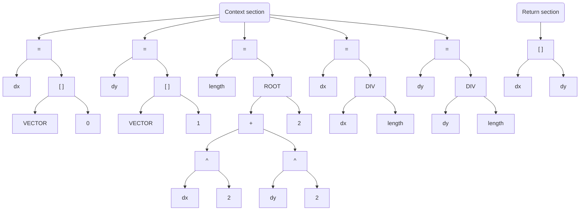

# Evaluation

Evaluation is the entire process of turning the formula expression into calculated result.

## Evaluation steps
1. **[Clean-up](./cleanup.md)** – Removing unnecessary white spaces and comments.
2. **[Tokenization](./tokenization.md)** – Splitting the formula into elementary tokens.
3. **[Parsing](./parsing.md)** – Converting tokens into primitives and building an abstract syntax tree.
4. **[Computation](./computation.md)** – Calculating function results based on their parameters.
5. **[Finalization](./finalization.md)** – Processing and returning the final result.

## Related processes
- **Pre-evaluation** - Process of gathering all necessary data to evaluate the formula from [**environment**](../core/environment.md) in a form of [**context**](../core/context.md).
- **Post-evaluation** - Process of extracting and utilizing the computed result in a program.

## Example

### 1. Pre-evaluation

#### Context:

Context for this example contains single constant:

| Name | Type | Value |
| :--- | :--- | :---- |
| VECTOR | `Array` | [ 15, 20 ] |

#### Formula:

```
# Vector length normalization formula

# Assuming that VECTOR is an array type constant provided by context.
$ dx = VECTOR[0]; dy = VECTOR[1]

$ length = ROOT(dx^2 + dy^2, 2)
$ dx = DIV(dx, length); dy = DIV(dy, length)

# Result
[dx, dy]
```

### 2. Clean-up

#### Compressed formula

```
$dx=VECTOR[0];dy=VECTOR[1]
$length=ROOT(dx^2+dy^2,2)
$dx=DIV(dx,length);dy=DIV(dy,length)
[dx,dy]
```

### 3. Tokenization

#### Expression tree:



## Reference
- [Context](../core/context.md)
- [Environment](../core/environment.md)
- [Evaluation](./evaluation.md)
- [Clean-up](./cleanup.md)