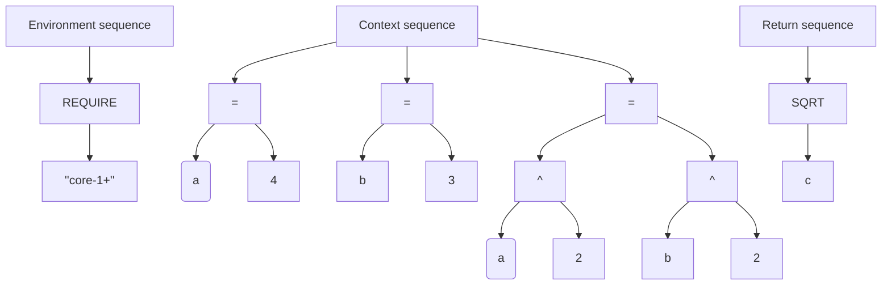

# Parsing

**Parsing** is the third stage of the [evaluation](./evaluation.md) process, where the expression tree produced during [tokenization](./tokenization.md), is traversed to determine the processing order, and each expression is resolved into its corresponding [primitive](../core/primitives.md).

## Parsing phases

### 1. Parsing queue

#### Description

The parsing queue determines the expression processing order. The expression tree is traversed **bottom-up** — leaf nodes (deepest expressions with no dependencies) are enqueued first, while root nodes (top-level operators and functions) are enqueued last.

This guarantees that by the time a parent expression is evaluated, all of its child expressions have already been resolved into primitives.

Each expression is assigned a **level** corresponding to its depth in the tree, where higher levels represent deeper nodes.

### 2. Translation table

#### Description

The translation table maps infix operator expressions to their equivalent function or procedure calls. During this step, each operator expression in the parsing queue is replaced with its canonical function-call form. This normalization ensures that all subsequent processing works uniformly with function calls, regardless of whether the original formula used operator syntax or explicit function calls.

### 3. Primitive map

#### Description

The primitive map is a key-value mapping that associates each unique expression string with its resolved [primitive](../core/primitives.md). As expressions are dequeued and processed, each one is classified and stored in this map.

#### Map structure

| Component | Description |
| :-------- | :---------- |
| **Key** | The raw expression string as it appears in the formula. |
| **Value** | The corresponding primitive (value, variable, or function) derived from the expression. |

This structure enables efficient lookup and deduplication — if the same expression appears multiple times in the formula, it is parsed only once and reused from the map.

### 4. Reference tree

#### Description

The reference tree stores references to every object in the form of a final hierarchical tree. It allows skipping the evaluation process up to validation, if an unchanged formula is called multiple times. It is also used to compute lambda functions.

## Example

### Formula:

```
@ REQUIRE "core-1+"

$ a = 4
$ b = 3
$ c = a^2 + b^2

SQRT(c)
```

### Expression tree:



### Queue

#### Environment queue:

| Level | Expressions |
| :---: | :---------- |
| 2 | `REQUIRE` |
| 1 | `"core-1+"` |

#### Context queue:

| Level | Expressions |
| :---: | :---------- |
| 3 | `a` `b` `2` |
| 2 | `a` `b` `3` `4` `^` |
| 1 | `=` |

#### Result queue:

| Level | Expressions |
| :---: | :---------- |
| 2 | `SQRT` |
| 1 | `c` |

### Translation table

| Operator | Translation |
| :--: | :--: |
| `a=b` | `SET a b` |
| `a^b` | `POW(a,b)` |

### Primitive map:

| Expression | Primitive type | Base type | Value |
| :--------- | :------------- | :----------- | :---- |
| `2` | Value | `Number` | 2.0 |
| `3` | Value | `Number` | 3.0 |
| `4` | Value | `Number` | 4.0 |
| `a` | Variable | `Undefined` | |
| `b` | Variable | `Undefined` | |
| `c` | Variable | `Undefined` | |
| `SQRT` | Function | `Number` | |
| `SET` | Function | `Error` | |
| `REQUIRE` | Function | `Error` | |
| `"core-1+"` | Value | `Text` | core-1+ |

> [!NOTE] Note: 
> In this example, all variables are **undefined**, because they don't exist in the context yet.
> Extracting existing context variables will preserve their types and values.

## Reference

- [Context](../core/context.md)
- [Environment](../core/environment.md)
- [Evaluation](./evaluation.md)
- [Tokenization](./tokenization.md)
- [Primitives](../core/primitives.md)