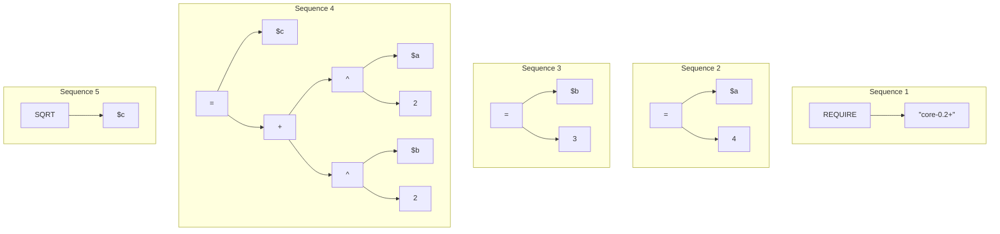

# Parsing

**Parsing** is the fourth stage of the [execution](./execution.md) process. The token stream produced during [tokenization](./tokenization.md) is divided into [sequences](../core/formula.md#formula-sequences), and each sequence is parsed into its own expression tree. The trees are traversed to determine the processing order and to resolve expressions into their corresponding [primitives](../core/primitives.md).

| Parameter | Description |
| :-- | :---------- |
| **Input** | Array of [tokens](./token.md). |
| **Output** | Array of reference trees (one per sequence), the parsing queue of every sequence, and the primitive map shared by the whole formula. |

Operator roles, binding power, delimiter contexts, and parser validation rules are defined in [Operator Parsing](operator-parsing.md). The required algorithm and syntax validation rules for the **Core** standard are defined in [Core Parsing](../standards/core/semantics/parsing.md).

If the parser finds a syntax error, parsing stops and the error becomes the result of the execution.


## Parsing algorithm

Every standard may inherit the parser algorithm from the [**Core**](../standards/core/README.md) standard, or override it.


## Parsing phases

### 1. Parsing queue

#### Description

The parsing queue determines the expression processing order. A separate queue is built for every sequence, so sequences are processed in formula order and a sequence can use the results (for example, assigned variables) of the sequences before it.

Each expression of a tree is assigned a **level** corresponding to its depth: the root expression of a sequence has level **1**, its operands have level **2**, and so on. Higher levels represent deeper nodes.

The queue is ordered **bottom-up**: expressions with the highest level are enqueued first, and the root expression is enqueued last. Expressions of the same level keep their order from the formula (left to right). This guarantees that by the time a parent expression is evaluated, all of its child expressions have already been resolved into primitives.

### 2. Translation table

#### Description

The translation table maps operator expressions to their equivalent function or procedure calls. During this step, each operator expression in the parsing queue is replaced with its canonical function-call form, in which arguments are separated by `,` and there are no spaces. After this step, the next stages work only with function calls, whether the formula used operators or function calls.

The translations of the **Core** operators are listed in [Core Parsing](../standards/core/semantics/parsing.md#operator-translation).

### 3. Primitive map

#### Description

The primitive map is a key-value mapping that associates each unique expression with its resolved [primitive](../core/primitives.md). As expressions are dequeued and processed, each one is classified and stored in this map.

#### Map structure

| Component | Description |
| :-------- | :---------- |
| **Key** | The expression in its canonical form: operators and procedure calls without parentheses are written as function calls (see [translation](#2-translation-table)), as they appear in the cleaned formula. |
| **Value** | The corresponding primitive (value, variable, constant, or function) derived from the expression. |

Because of this structure, an expression that occurs many times in the formula is parsed only once and then taken from the map.

#### Primitive classification

| Expression | Primitive | Base type |
| :--------- | :-------- | :-------- |
| Literal (`4`, `"text"`, `true`) | Value | The literal's type. |
| Variable with a `$` or `@` sigil | Variable | The current type of the variable. A variable that does not exist yet, or has no value, has the `Undefined` placeholder type; its value is read during [evaluation](./evaluation.md#2-direct-extraction). |
| Identifier without a sigil or parentheses | Constant (or lambda parameter inside a lambda body) | The constant's type. |
| Function or procedure call | Function | The return type of the function (`Error` for procedures). |
| Lambda expression | Lambda function | The type returned by the lambda body. |

The body of a lambda expression is not classified in the shared map: it is parsed [autonomously](#lambda-trees).

### 4. Reference tree

#### Description

The reference tree stores references to every object in the form of a final hierarchical tree: one tree per sequence, whose nodes point to entries of the primitive map instead of storing expression strings. It allows skipping clean-up, tokenization, and parsing if an unchanged formula is executed multiple times.

#### Lambda trees

The body of a [lambda function](../core/functions.md#named-and-anonymous-functions) is parsed **autonomously**, once, during the parsing of the formula:

- the body gets its own expression tree, its own parsing queue and its own primitive map, separate from those of the sequence that contains the lambda expression;
- lambda parameters are **leaf** nodes of that tree and are left unresolved — they have no value until the lambda is invoked;
- the resulting tree is stored in the lambda primitive and is never parsed again, however many times the lambda is invoked.

The lambda primitive in the shared primitive map therefore represents the whole function, and the entries of its body do not appear in the shared map. At invocation time only the [evaluation](./evaluation.md#lambda-invocation) of the stored tree is performed.


## Example

### Formula:

```
REQUIRE "core-0.2+"

$a = 4
$b = 3
$c = $a^2 + $b^2

SQRT($c)
```

After [clean-up](./cleanup.md) the formula has five sequences: `REQUIRE "core-0.2+"`, `$a=4`, `$b=3`, `$c=$a^2+$b^2` and `SQRT($c)`.

### Expression trees:



### Parsing queues

Expressions are listed from the first one to be processed (highest level) to the last one (level 1).

| Sequence | Level | Expressions |
| :------: | :---: | :---------- |
| 1 | 2 | `"core-0.2+"` |
| 1 | 1 | `REQUIRE` |
| 2 | 2 | `$a` `4` |
| 2 | 1 | `=` |
| 3 | 2 | `$b` `3` |
| 3 | 1 | `=` |
| 4 | 4 | `$a` `2` `$b` `2` |
| 4 | 3 | `^` `^` |
| 4 | 2 | `$c` `+` |
| 4 | 1 | `=` |
| 5 | 2 | `$c` |
| 5 | 1 | `SQRT` |

### Translation table

| Operator expression | Translation |
| :------------------ | :---------- |
| `$a=4` | `SET($a,4)` |
| `$b=3` | `SET($b,3)` |
| `$a^2` | `POW($a,2)` |
| `$b^2` | `POW($b,2)` |
| `POW($a,2)+POW($b,2)` | `ADD(POW($a,2),POW($b,2))` |
| `$c=ADD(POW($a,2),POW($b,2))` | `SET($c,ADD(POW($a,2),POW($b,2)))` |

### Primitive map:

| Expression | Primitive type | Base type | Value |
| :--------- | :------------- | :-------- | :---- |
| `"core-0.2+"` | Value | `Text` | core-0.2+ |
| `REQUIRE("core-0.2+")` | Function | `Error` | |
| `$a` | Variable | `Undefined` | |
| `4` | Value | `Number` | 4.0 |
| `SET($a,4)` | Function | `Error` | |
| `$b` | Variable | `Undefined` | |
| `3` | Value | `Number` | 3.0 |
| `SET($b,3)` | Function | `Error` | |
| `2` | Value | `Number` | 2.0 |
| `POW($a,2)` | Function | `Number` | |
| `POW($b,2)` | Function | `Number` | |
| `ADD(POW($a,2),POW($b,2))` | Function | `Number` | |
| `$c` | Variable | `Undefined` | |
| `SET($c,ADD(POW($a,2),POW($b,2)))` | Function | `Error` | |
| `SQRT($c)` | Function | `Number` | |

> [!NOTE]
> The expressions `$a`, `$b`, `$c` and `2` occur in the formula several times, but each has a single map entry.
>
> In this example, all variables are **undefined**, because they don't exist in the context yet. Extracting existing context variables preserves their types and values.
>
> The formula's result is the value of the **last evaluated sequence** — here, the result of `SQRT($c)`, which is `5` once the formula is computed.


## Reference

- [Context](../core/context.md)
- [Environment](../core/environment.md)
- [Formula](../core/formula.md)
- [Execution](./execution.md)
- [Clean-up](./cleanup.md)
- [Tokenization](./tokenization.md)
- [Operator Parsing](./operator-parsing.md)
- [Core Parsing](../standards/core/semantics/parsing.md)
- [Evaluation](./evaluation.md)
- [Primitives](../core/primitives.md)
