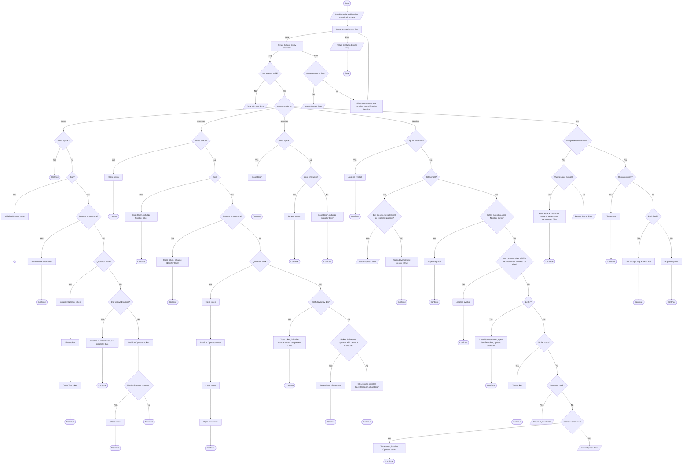

# Tokenization

**Tokenization** is the third stage of the [execution](./execution.md) process, where the formula string is being split into sequences, and sequences are being split into expressions identified by [tokens](./token.md).


## Tokenization algorithm

### Text algorithm

1. Load the post-clean-up **formula text** and initialize the [**tokenization state**](#tokenization-state).
2. Iterate through every **character** of every **line** of the input text:
   1.  If **current character** is not a [valid symbol](../syntax/symbols.md#symbols-list), then stop the process and return an **error**.
   2. Else, if **current mode** is **None**:
      1. If the **current character** is a **white space**, ignore it and continue.
      2. Else, if the current character is a [**digit**](../syntax/symbols.md#symbols-classification), open the **Number** token and append symbol.
      3. Else, if the current character is a **letter** or **underline (`_`)**, open the **Identifier** token and append symbol.
      4. Else, if the **current character** is a **quotation mark (`"`)**, initialize **Operator** token, close it,  open the **Text** token and continue.
      5. Else, if the **current character** is a **dot symbol (`.`)** and the **next character** is a [**digit**](../syntax/symbols.md#symbols-classification), open the **Number** token, append symbol and set **dot present** to **true**.
      6. Else, open the **Operator** token and append symbol,
         1. Then, if the **current character** is a [**single character operator**](../syntax/operators.md#operator-length), close the token.
         2. Otherwise, continue.
   3. Else, if **current mode** is **Operator**:
      1. If the **current character** is a **white space**, close the token.
      2. Else, if the current character is a [**digit**](../syntax/symbols.md#symbols-classification), close the token, open a **Number** token and append symbol.
      3. Else, if the current character is a **letter** or **underline (`_`)**, close the token, initialize **Identifier** token.
      4. Else, if the **current character** is a **quotation mark (`"`)**, then close the **current token**, open the **Text** token and continue.
      5. Else, if the **current character** is a **dot symbol (`.`)** and the **next character** is a [**digit**](../syntax/symbols.md#symbols-classification), close the **current token**, open the **Number** token, append symbol and set **dot present** to **true**.
      6. Else, if **previous character** and **current character** make a correct [**2-character operator**](../syntax/operators.md#operator-length), append character and close the token.
      7. Else, close the token, open **Operator** token, append symbol and close the token.
   4. Else, if **current mode** is **Identifier**:
      1. If the **current character** is a **white space**, close the token.
      2. Else, if the current character is a [**word character**](../syntax/symbols.md#symbols-classification), append symbol.
      3. Else, close the token, open an **Operator** token and append symbol.
   5. Else, if **current mode** is **Number**:
      1. If **current character** is a [**digit**](../syntax/symbols.md#symbols-classification) or **underline (`_`)**, append symbol.
      2. Else, if **current character** is a **dot symbol (`.`)**:
         1. If **dot present** is **true**, or the **current token** is hexadecimal (starts with `0x` or `0X`), or it already contains an exponent marker (`e` or `E`), stop the process and return **syntax error**.
         2. Else, append symbol and set **dot present** to **true**.
      3. Else, if **current character** is a **letter** and appending it keeps the token a prefix of a valid **Number** literal in the active standard (for example `e` or `E` in a decimal token, `x` or `X` after a leading `0`, a hexadecimal digit in a hexadecimal token), append it.
      4. Else, if **current character** is a **plus (`+`)** or **minus (`-`)** symbol, **previous character** is `e` or `E`, the **current token** is not hexadecimal, and **next character** is a digit, append symbol (sign of the exponent).
      5. Else, if **current character** is a **letter**, close the current token, open an **Identifier** token, and append the character.
      6. Else, if **current character** is a **white space**, close the current token.
      7. Else, if **current character** is a **quotation mark (`"`)**, stop the process and return **syntax error**.
      8. Else, if **current character** is an [**operator character**](../syntax/symbols.md#symbols-classification), close the current token and initialize **Operator** token with **current character**. This includes `+` and `-` outside of an exponent, which are always operators.
      9. Else, stop the process and return **syntax error**.
   6. Else, if **current mode** is **Text**:
      1. If **escape sequence** is **true**:
         1. If **current character** is [**escape sequence symbol**](../syntax/symbols.md#symbols-classification), build escape sequence output character and append to the **current token**. Then, set **escape sequence** to **false**.
         2. Else, stop the process and return **syntax error**.
      2. If **escape sequence** is **false**:
         1. If **current character** is **quotation mark (`"`)**, close the token, initialize **Operator** token and close it.
         2. Else, if **current character** is **backslash (`\`)**, set **escape sequence** to **true**.
         3. Else, append symbol.
   7. After the last character of every line:
      1. If **current mode** is **Text**, stop the process and return **syntax error** (a text literal must be a single-line character sequence).
      2. Else, if a token is open, close it.
      3. Then, if it is not the last line, add a `[New line]` **Operator** token to the **tokens** array.
3. Return the **tokens** array.

### Decision tree



### Decision table

<table>
   <tr align="center">
      <td></td>
      <td colspan="5">Mode</td>
   </tr>
   <tr align="center">
      <td>Current character</td>
      <td>None</td>
      <td>Operator</td>
      <td>Identifier</td>
      <td>Number</td>
      <td>Text</td>
   </tr>
   <tr align="center">
      <td>White space (<code>Space</code>, <code>Tab</code>)</td>
      <td>Ignore it</td>
      <td>Close the token</td>
      <td>Close the token</td>
      <td>Close the token</td>
      <td>Append symbol</td>
   </tr>
   <tr align="center">
      <td>Underline (<code>_</code>)</td>
      <td>Initialize <b>Identifier</b> token</td>
      <td>Close token and initialize <b>Identifier</b> token</td>
      <td>Append symbol</td>
      <td>Append symbol</td>
      <td>Append symbol</td>
   </tr>
   <tr align="center">
      <td>Letter (<code>a-z</code>, <code>A-Z</code>)</td>
      <td>Initialize <b>Identifier</b> token</td>
      <td>Close token and initialize <b>Identifier</b> token</td>
      <td>Append symbol</td>
      <td>Append only if it keeps a valid number prefix in the active standard (<code>e</code> or <code>E</code> in a decimal token, <code>x</code> after a leading <code>0</code>, a hexadecimal digit in a hexadecimal token); otherwise close token and initialize <b>Identifier</b> token</td>
      <td>Append symbol</td>
   </tr>
   <tr align="center">
      <td>Digit (<code>0-9</code>)</td>
      <td>Initialize <b>Number</b> token</td>
      <td>Close token and initialize <b>Number</b> token</td>
      <td>Append symbol</td>
      <td>Append symbol</td>
      <td>Append symbol</td>
   </tr>
   <tr align="center">
      <td>Dot (<code>.</code>)</td>
      <td>If followed by digit: Initialize <b>Number</b><br/>Else: Initialize <b>Operator</b></td>
      <td>If followed by digit: Close and initialize <b>Number</b><br/>Else: Handle as <b>Operator</b></td>
      <td>Close token and initialize <b>Operator</b> token</td>
      <td>If dot present, token is hexadecimal or contains an exponent: <b>Syntax error</b><br/>Else: Append symbol and set <b>dot present</b></td>
      <td>Append symbol</td>
   </tr>
   <tr align="center">
      <td>Plus (<code>+</code>) or minus (<code>-</code>)</td>
      <td>Initialize <b>Operator</b> token</td>
      <td>Handle as <b>Operator</b></td>
      <td>Close token and initialize <b>Operator</b> token</td>
      <td>If previous character is <code>e</code> or <code>E</code>, token is decimal and next character is a digit: Append symbol<br/>Else: Close token and initialize <b>Operator</b> token</td>
      <td>Append symbol</td>
   </tr>
   <tr align="center">
      <td>Quotation mark (<code>"</code>)</td>
      <td>Open <b>Text</b> token</td>
      <td>Close token and open <b>Text</b> token</td>
      <td>Close token and initialize <b>Operator</b> token</td>
      <td><b>Syntax error</b></td>
      <td>Close the token</td>
   </tr>
   <tr align="center">
      <td>Backslash (<code>\</code>)</td>
      <td>Initialize <b>Operator</b> token</td>
      <td>Handle as <b>Operator</b></td>
      <td>Close token and initialize <b>Operator</b> token</td>
      <td><b>Syntax error</b></td>
      <td>Set <b>escape sequence</b> to <b>true</b></td>
   </tr>
   <tr align="center">
      <td>Other operator character</td>
      <td>Initialize <b>Operator</b> token</td>
      <td>Append and close (if 2-char) <br/> <i>or</i> <br/> Close, initialize new <b>Operator</b> and close</td>
      <td>Close token and initialize <b>Operator</b> token</td>
      <td>Close token and initialize <b>Operator</b> token</td>
      <td>Append symbol</td>
   </tr>
</table>


## Tokenization state

Tokenization state is a structure used to determine the tokenizator's behaviour under specific conditions

| Property | Description | Default value |
| :------: | :---------- | :-----------: |
| Tokens | Array of evaluated **tokens** serving as a tokenization result. | [ ] <br/> (empty array) |
| Mode | Defines [**type**](./token.md#token-types) of the token, that will be added to the collection and determines set of actions that will be taken after reaching next character.  | **None** |
| Current token | Array of symbols representing **current token's** value. | [ ] <br/> (empty array) |
| Current character | Symbol analyzed in current loop iteration. | null / undefined |
| Previous character | Symbol to the **left** of the **current character**. | null / undefined |
| Next character | Symbol to the **right** of the **current character**. | null / undefined |
| Dot present | **Dot symbol (`.`)** is present in **current token** (applies only for **Number** tokens). | **false** |
| Escape sequence | Next character will be processed as a part of [**escape sequence**](../syntax/symbols.md#escape-sequences). | **false** |


## State actions

Actions that modify the tokenization state in an organized way

| Action | Explanation | Requirements |
| :----: | :---------- | :----------: |
| Update previous mode | Sets value of **previous mode** to the value of **mode**, if it's different than **None**. | - |
| Set mode | Updates **previous mode**, then sets **mode** to the provided [**token type**](./token.md#token-types). | - |
| Reset mode | Sets **mode** back to **None**. | - |
| Append symbol / character | Appends the **current character** at the end of the currently evaluated token's value. | **Current token** must be opened and **Mode** must be other than **None** |
| Open token | Sets mode to the provided [**token type**](./token.md#token-types) and creates a token for next characters to append. | Current token must be closed |
| Close token | Ends the **current token**, adds it to the **tokens** array, and resets mode. Also sets **dot present** and **escape sequence** to **false**. | Current token must be opened |
| Initialize token | Open the token with specified type and append **current character**. | Current token must be closed |
| Continue | Stops all further actions and proceed to the next character / iteration. | - |
| Build escape sequence output character | Creates a symbol from escape sequence: <br/> `\` (`\\`) -> `\` <br/> `"` (`\"`) -> `"` <br/> `t` (`\t`) -> `[Tab]` <br/> `n` (`\n`) -> `[New line]` | - |


## Example

### Input formula

```
$message = "12.5[rad] in [deg] is:"
$angle := 12.5 * 180 / PI
FORMAT("%s\n%.1f", [$message, $angle])
```

### Tokenization process

#### 1. First line:

   1. `$` symbol is an operator - new **Operator** token is initialized
   2. `$` is a 1-character operator (sigil) - token is closed
   3. `m` symbol is a letter - new **Identifier** operator is initialized
   4. `e`, `s`, `s`, `a`, `g`, `e` symbols are letters - they are being appended to current token
   5. White space in **Identifier** mode - token is closed
   6. `=` symbol is an operator - new **Operator** token is initialized
   7. White space in **Operator** mode - token is closed
   8. `"` symbol is text delimiter - new Operator token is initialized and closed, then a new Text token is opened.
   9. `1`, `2`, `.`, `5`, `[`, `r` ... `s`, `:` symbols are processed as text - appended to current token
   10. `"` symbol is text delimiter - **Text** token is closed, then a new Operator token is initialized and closed

#### 2. Second line:

   1. `$` symbol is an operator - new **Operator** token initialized and closed immediately
   2. `a`, `n`, `g`, `l`, `e` are letters - new **Identifier** token opened and populated
   3. `:` is an operator symbol - new **Operator** token initialized
   4. `=` makes a valid 2-character operator `:=` with previous character - appended and closed
   5. `1`, `2`, `.`, `5` are digits and a dot - new **Number** token opened and populated
   6. `*` is an operator - new **Operator** token initialized and closed
   7. `1`, `8`, `0` are digits - new **Number** token opened and populated
   8. `/` is an operator - new **Operator** token initialized and closed
   9. `P`, `I` are letters - new **Identifier** token opened and populated

#### 3. Third line:

   1. `F`, `O`, `R`, `M`, `A`, `T` are letters - new **Identifier** token initialized and populated
   2. `(` is an operator - **Identifier** token closed, new **Operator** token initialized and closed
   3. `"` initializes and closes an **Operator** token, then opens a **Text** token. `\n` triggers **escape sequence**, resulting in a New Line character being appended. `"` closes the token, then initializes and closes the **Operator** token
   4. `,` is an operator - new **Operator** token initialized and closed
   5. `[` is an operator - new **Operator** token initialized and closed
   6. `$` is parsed as **user variable** sigil, `message` as **Identifier**, `,` as **Operator**, `$` as **user variable** sigil, `angle` as **Identifier**
   7. `]` and `)` are parsed as single-character **Operators**

### Tokenization result

```
$message = "12.5[rad] in [deg] is:"
$angle := 12.5 * 180 / PI
FORMAT("%s\n%.1f", [$message, $angle])
```

|  #  | Token | Type |
| :-: | :---- | :--: |
| 1 | `$` | Operator |
| 2 | `message` | Identifier |
| 3 | `=` | Operator |
| 4 | `"` | Operator |
| 5 | `12.5[rad] in [deg] is:` | Text |
| 6 | `"` | Operator |
| 7 | `[New line]` | Operator |
| 8 | `$` | Operator |
| 9 | `angle` | Identifier |
| 10 | `:=` | Operator |
| 11 | `12.5` | Number |
| 12 | `*` | Operator |
| 13 | `180` | Number |
| 14 | `/` | Operator |
| 15 | `PI` | Identifier |
| 16 | `[New line]` | Operator |
| 17 | `FORMAT` | Identifier |
| 18 | `(` | Operator |
| 19 | `"` | Operator |
| 20 | `%s\n%.1f` | Text |
| 21 | `"` | Operator |
| 22 | `,` | Operator |
| 23 | `[` | Operator |
| 24 | `$` | Operator |
| 25 | `message` | Identifier |
| 26 | `,` | Operator |
| 27 | `$` | Operator |
| 28 | `angle` | Identifier |
| 29 | `]` | Operator |
| 30 | `)` | Operator |


## Reference

- [Execution](./execution.md)
- [Clean-up](./cleanup.md)
- [Operator Parsing](./operator-parsing.md)
- [Parsing](./parsing.md)
- [Functions](../core/functions.md)
- [Containers](../core/containers.md)
- [Primitives](../core/primitives.md)
- [Literals](../syntax/literals.md)
