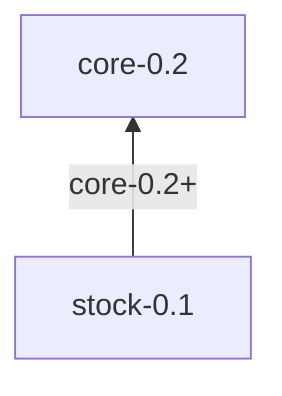

# Standards

**FormuLang** standards make sure that different applications execute the same formula in the same way.
Every standard defines the structure of the **environment** and the **context**, its built-in functions, procedures, types and errors.

## Standard list

Core standard

| Name | Latest version | Description |
| :--- | :------------: | :---------- |
| `core` | `0.2` | Basic mathematical, logical, text and array operations. Basis of every other extension. [[Read more]](./core/README.md) |

Extension standards

| Name | Latest version | Requires | Description |
| :--- | :------------: | :------: | :---------- |
| `stock` | `0.1` (in progress) | `core-0.2+` | Market data: candles, technical indicators, candle patterns and trading strategies. [[Read more]](./stock/README.md) |

## Dependency tree

An arrow points from a standard to the standard it requires, with the required versions ([`REQUIRE`](core/procedures/REQUIRE.md) format). A standard has every element of the standards it requires: e.g. the Stock context types derive from the Core Iteration Context.



```
core-0.2
└── stock-0.1      (requires core-0.2+)
```

## Reference
- [Context](../core/context.md)
- [Environment](../core/environment.md)
